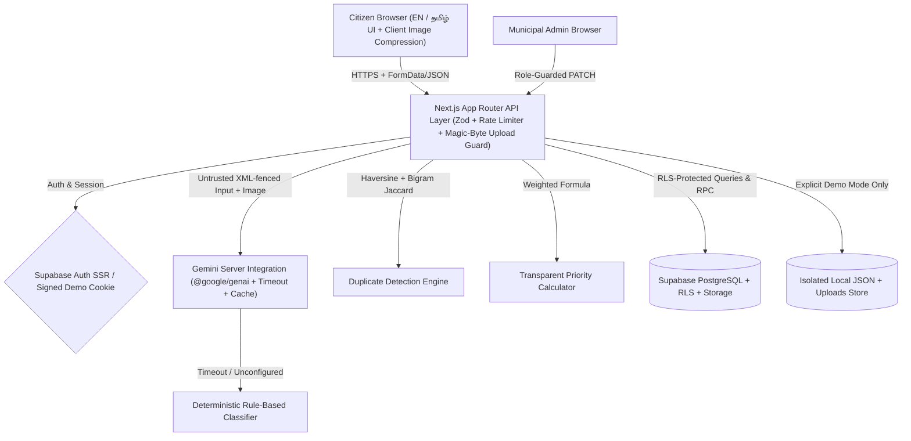

# CivicLens AI — Intelligent Civic Issue Detection, Prioritization & Resolution Platform

CivicLens AI is a full-stack, bilingual (**English & Tamil**) smart-city civic infrastructure reporting, triage, deduplication, and municipal resolution tracking platform built with **Next.js App Router, TypeScript (strict mode), Tailwind CSS, Zod, Supabase PostgreSQL/Auth/Storage, and Google Gemini API**.

---

## 1. Problem Statement & Proposed Solution

### Problem Statement
Municipalities receive thousands of unorganized citizen complaints across disparate channels (hotlines, social media, walk-ins) without structured severity assessment, spatial deduplication, or transparent status tracking. High-risk hazards—such as burst water mains near hospitals or exposed live streetlight wiring beside school crossings—frequently get buried behind low-impact maintenance requests, while duplicate reports waste inspection crew hours.

### Proposed Solution
CivicLens AI establishes an end-to-end, accountable civic workflow:
1. **Citizen Submission**: Authenticated citizens submit structured reports with category, description, street address/ward, interactive map coordinates, browser GPS, and client-compressed/server-verified evidence photos (with accessibility alt text).
2. **AI-Assisted Triage (Gemini + Deterministic Fallback)**: Server-side Gemini integration outputs strict Zod-validated JSON predicting category, severity (`low | medium | high | critical`), urgency (1–100), public impact (1–100), severity explanation, and actionable municipal recommendations—with deterministic heuristic fallback when offline or unconfigured.
3. **Spatial + Textual Duplicate Detection**: Combines Haversine geographic proximity (≤ 400 m) with bilingual token + bigram Jaccard similarity (preserving Tamil Unicode `\p{M}` combining marks) to alert citizens and administrators to existing nearby open reports.
4. **Transparent Priority Engine**: Ranks work using an explicit, auditable formula:
   $$\text{Priority} = 0.40 \times \text{Severity} + 0.30 \times \text{Urgency} + 0.25 \times \text{Impact} + 0.05 \times \text{CommunitySignal}$$
5. **Role-Authorized Municipal Dispatch**: Administrators verify submissions, link duplicates, assign departments/crews, and transition status (`Submitted → Verified → Assigned → In Progress → Resolved | Rejected`), automatically writing an audit trail (`issue_history`) and citizen notifications (`notifications`).
6. **Live Stored Analytics**: Computes resolution rates, mean resolution time, category/severity/ward distributions directly from stored records without fabricated metrics.

---

## 2. Architecture & Data-Flow Diagram



---

## 3. Technology Stack

- **Frontend & SSR**: Next.js 16 (App Router), React 19, TypeScript 5 (`strict`, `noUncheckedIndexedAccess`), Tailwind CSS 4, Lucide Icons, Leaflet (OpenStreetMap interactive map + synchronized keyboard-accessible pin list)
- **Backend & Validation**: Next.js Route Handlers, Zod schema validation, sliding-window rate limiter, HMAC-SHA256 demo cookies, magic-byte file signature inspection
- **Database, Auth & Storage**: Supabase PostgreSQL (with Row Level Security, GIN full-text index, composite indexes, atomic `upvote_civic_issue` RPC), Supabase Auth (`@supabase/ssr`), Supabase Storage (`issue-evidence` private bucket)
- **AI Integration**: `@google/genai` server-side integration with XML prompt-injection fencing, 8.5s timeout, retry cap, SHA-256 LRU cache, and deterministic classifier fallback
- **Testing & Quality**: Vitest, React Testing Library, `axe-core`, Playwright E2E + `@axe-core/playwright`, ESLint, `tsc --noEmit`

---

## 4. Database Schema & Migration Instructions

The complete PostgreSQL schema, indexes, triggers, storage bucket rules, and Row Level Security policies live in:
- [`supabase/migrations/001_initial_schema.sql`](supabase/migrations/001_initial_schema.sql)

### Tables & Security Policies
1. `public.profiles` — 1:1 with `auth.users`; role escalation blocked by `trg_prevent_role_escalation` trigger + `is_admin()` helper.
2. `public.civic_issues` — Stores civic issues with zero reporter PII; indexed on `(status, priority_score DESC, created_at DESC)`, `(category, severity)`, `(reporter_id, created_at DESC)`, `(latitude, longitude)`, and full-text GIN index.
3. `public.issue_history` — Immutable audit log of citizen & admin workflow actions.
4. `public.notifications` — Per-user status update alerts with strict `auth.uid() = user_id` RLS.
5. `public.issue_upvotes` + `public.upvote_civic_issue(p_issue_id)` — Atomic `SECURITY DEFINER` RPC preventing duplicate corroboration and securely recalculating priority under RLS.
6. `storage.buckets` (`issue-evidence`) — Private 5 MB limit bucket accepting only `image/jpeg`, `image/png`, and `image/webp`.

### Applying Migrations in Supabase
1. Create a new Supabase project at <https://supabase.com>.
2. Open **SQL Editor** in the Supabase dashboard (or run `supabase db push` via Supabase CLI).
3. Execute the contents of `supabase/migrations/001_initial_schema.sql`.
4. To promote an administrator account after registering:
   ```sql
   UPDATE public.profiles SET role = 'admin' WHERE id = '<ADMIN_AUTH_USER_UUID>';
   ```

---

## 5. Local Installation & Environment Variables

### Prerequisites
- Node.js 20+ (tested on Node v26.13.1) and npm 10+

### Setup
```bash
git clone <your-repo-url>
cd Vibeathon
npm install
cp .env.example .env.local
```

### Environment Variables (`.env.example`)
| Variable | Scope | Description |
| --- | --- | --- |
| `NEXT_PUBLIC_SUPABASE_URL` | Public | Supabase project URL |
| `NEXT_PUBLIC_SUPABASE_ANON_KEY` | Public | Supabase anonymous public key |
| `SUPABASE_SERVICE_ROLE_KEY` | **Server-only** | Used strictly on the server for verified evidence signed URLs |
| `GEMINI_API_KEY` | **Server-only** | Google Gemini API key (never exposed to browser) |
| `GEMINI_MODEL` | Server-only | Optional model override (default `gemini-2.5-flash`) |
| `CIVICLENS_SESSION_SECRET` | **Server-only** | 32+ char secret for signed demo session cookies |
| `CIVICLENS_ALLOW_DEMO_MODE` | Server-only | Set `true` only for local evaluation without Supabase |
| `CIVICLENS_ADMIN_EMAILS` | Server-only | Optional comma-separated admin emails for demo mode |
| `NEXT_PUBLIC_APP_URL` | Public | Base URL (`http://localhost:3000` locally) |

### Run Development Server
```bash
npm run dev
```
Open <http://localhost:3000>. When Supabase keys are absent and `CIVICLENS_ALLOW_DEMO_MODE=true`, CivicLens AI displays an explicit **Local Demo Store Active** banner and allows local testing with seeded demo accounts (`citizen@civiclens.local` / `Citizen123!`, `admin@civiclens.local` / `Admin123!`).

---

## 6. Testing & Verification

```bash
# TypeScript strict check
npm run typecheck

# ESLint check
npm run lint

# Unit, security, integration & accessibility tests (Vitest + axe-core)
npm test

# End-to-end Playwright suite (install Chromium once via: npx playwright install chromium)
npm run test:e2e

# Production build
npm run build
```

---

## 7. Deployment on Vercel

1. Push the repository to GitHub (ensure `.env.local`, `.civiclens-data/`, `.next/`, and `node_modules/` are ignored via `.gitignore`).
2. Import the repository in **Vercel → Add New Project**.
3. Configure all production environment variables (`NEXT_PUBLIC_SUPABASE_URL`, `NEXT_PUBLIC_SUPABASE_ANON_KEY`, `SUPABASE_SERVICE_ROLE_KEY`, `GEMINI_API_KEY`, `CIVICLENS_SESSION_SECRET`, `NEXT_PUBLIC_APP_URL`, and set `CIVICLENS_ALLOW_DEMO_MODE=false`).
4. Deploy with the default Next.js build command (`npm run build`).

---

## 8. Known Limitations

- **Demo Mode vs Live Mode**: Without Supabase credentials, the app falls back to an isolated local JSON file store (`.civiclens-data/`) when `CIVICLENS_ALLOW_DEMO_MODE=true`. Because Vercel serverless instances have ephemeral filesystems, **Supabase PostgreSQL + Storage must be configured for production deployments**.
- **AI Triage Scope**: When `GEMINI_API_KEY` is absent or the Gemini API times out, the deterministic classifier evaluates text keywords and hazard indicators only—it does not inspect image pixels. Even with Gemini enabled, AI triage is advisory and requires municipal admin verification before field dispatch.
- **Rate Limiting**: The built-in sliding-window rate limiter operates per Node process; for multi-region serverless scale, pair it with Redis/Upstash or Vercel WAF rate limiting.
- **Map Tiles**: OpenStreetMap tiles require outbound browser internet access; when offline, the synchronized keyboard-accessible pin index remains fully functional.

---

## 9. Screenshots

Add captured screenshots from your deployed or local instance in `docs/screenshots/` after deployment:
- `Landing & Live KPI Overview`
- `Citizen Issue Reporting with AI Triage & Duplicate Check`
- `Interactive Civic Map & Issue Explorer`
- `Admin Triage Console & Municipal Analytics`

---

## License

MIT License — see [`LICENSE`](LICENSE).
